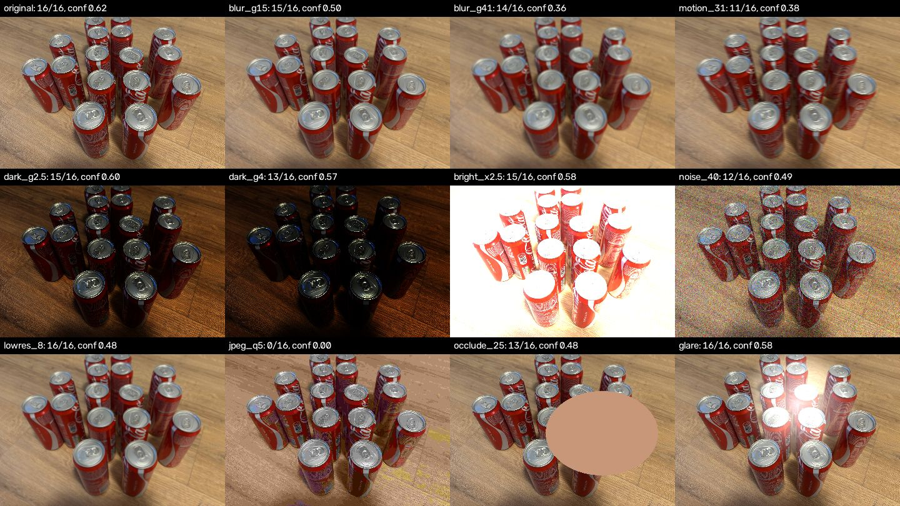

# Can Vision Confidence Trigger a Photo Retake?

**Date:** 2026-10-27
**Question:** can the Vision service use the confidence of its detections to tell
the Backend that a photo is too bad to count from, so the device takes another one?

**Short answer:** yes, for blurred, low-resolution and heavily compressed photos,
combined with a brightness check for dark and overexposed ones. Confidence does
not catch products hidden behind something (a hand), because a hidden product
produces no box and so no confidence at all.

## Current state

- `detect()` in [detect_yolo_tiled.py](../../Vision/detect_yolo_tiled.py) keeps a
  `confidence` for every box (boxes are kept from `CONFIDENCE = 0.10`).
- `POST /recognize` in [api.py](../../Vision/api.py) returns only `{"count": N}`;
  the confidences are thrown away.
- The Backend (`VisionClient`, `CameraImageService`) applies the count to stock
  without any check. `RecognitionResult.confidence` exists but is not filled.
- [RFC-0001](../rfcs/0001-image-ingestion-and-recognition-pipeline.md) and FR-08
  expect low-confidence results to go to manual review instead of changing stock.

## Method

The 25 labelled photos from `Vision/tests/data` (ADR-0010) were run through the
production detector unchanged, and so were 11 degraded copies of each, 300 runs in
total. For each run the script records the confidences of the counted boxes, the
mean brightness and the Laplacian sharpness of the frame.



| Variant | What it imitates |
|---|---|
| `blur_g15`, `blur_g41` | Out of focus (Gaussian blur, kernel 15 / 41 px) |
| `motion_31` | Camera or shelf moving during the shot |
| `dark_g2.5`, `dark_g4` | Poor lighting (gamma 2.5 / 4) |
| `bright_x2.5` | Overexposure |
| `noise_40` | Sensor noise in low light |
| `lowres_8` | Image 8× smaller than expected |
| `jpeg_q5` | Very strong compression |
| `occlude_25` | Hand or object over 25% of the frame |
| `glare` | Bright reflection on the cans |

The script is [Vision/experiments/confidence.py](../../Vision/experiments/confidence.py).

## Results

"Exact" means the count matched the label. "Uncertain" is the share of boxes with
confidence below 0.30. The last two columns show the retake rule from the
[Recommendation](#recommendation) section: mean confidence below 0.50, or
brightness outside 40–220.

| Variant | Exact | Mean error | Mean conf | p10 conf | Uncertain | Brightness | Retake: wrong caught | Retake: correct flagged |
|---|---|---|---|---|---|---|---|---|
| original | 100% | +0.0 | 0.69 | 0.55 | 3% | 119 | 0/0 | 0/25 |
| blur_g15 | 96% | -0.0 | 0.50 | 0.36 | 10% | 119 | 0/1 | 12/24 |
| blur_g41 | 40% | -0.9 | 0.34 | 0.22 | 46% | 119 | 15/15 | 10/10 |
| motion_31 | 24% | -2.0 | 0.37 | 0.21 | 45% | 119 | 16/19 | 6/6 |
| dark_g2.5 | 84% | -0.2 | 0.69 | 0.51 | 4% | 52 | 2/4 | 0/21 |
| dark_g4 | 48% | -0.8 | 0.64 | 0.49 | 6% | 27 | 13/13 | 12/12 |
| bright_x2.5 | 68% | -0.3 | 0.58 | 0.43 | 5% | 230 | 4/8 | 13/17 |
| noise_40 | 48% | -0.9 | 0.55 | 0.36 | 16% | 120 | 9/13 | 1/12 |
| lowres_8 | 68% | -0.4 | 0.46 | 0.31 | 16% | 119 | 6/8 | 12/17 |
| jpeg_q5 | 8% | -7.4 | 0.12 | 0.09 | 89% | 120 | 23/23 | 2/2 |
| occlude_25 | 16% | -2.4 | 0.64 | 0.45 | 8% | 129 | 2/21 | 0/4 |
| glare | 100% | +0.0 | 0.65 | 0.49 | 4% | 140 | 0/0 | 0/25 |

How well each signal separates wrong counts from correct ones (AUROC: 0.5 is a
coin toss, 1.0 is perfect):

| Signal | Any error (125 of 300 runs) | Error > 2 (46 of 300 runs) |
|---|---|---|
| Mean confidence | 0.76 | 0.79 |
| 10th percentile confidence | 0.78 | 0.82 |
| Share of uncertain boxes | 0.75 | 0.80 |
| Laplacian sharpness | 0.50 | 0.42 |

## Findings

1. **The model misses products, it does not invent them.** Every wrong count is
   too low. Confidence only describes the boxes that were found, so it can show
   that the found boxes are doubtful but not that some products were not found.
2. **Confidence drops clearly on blurred, low-resolution and compressed photos.**
   Mean confidence falls from 0.69 to 0.12–0.46, and the retake rule catches all
   15 heavily blurred and all 23 compressed runs with a wrong count.
3. **No false alarms on clean photos.** The lowest mean confidence among the 25
   original photos is 0.62, well above the 0.50 threshold; the glare variant also
   stays above it and is always counted correctly.
4. **Darkness is not visible in confidence.** At gamma 4 the mean confidence is
   still 0.64 while half of the counts are wrong. The brightness check catches all
   13 of them.
5. **Occlusion is not visible in either signal.** The visible cans are detected
   confidently and the hidden ones simply have no box: only 2 of 21 wrong counts
   are caught. This needs a check on the Backend side, e.g. the count dropped
   sharply compared with the previous photo of the same shelf.
6. **Laplacian sharpness is not a usable signal on its own.** It does fall to 2–11
   on blurred photos, but noise pushes it above 13 000, so no single threshold
   works. Confidence already reflects blur better.
7. **"Correct flagged" on degraded photos is not a real false alarm.** A heavily
   blurred or dark photo that happened to give the right count is still a bad
   photo, and asking for another one is the right reaction.

Overall the rule catches 90 of 125 wrong counts and never fires on a clean photo.
Of the 35 misses, 19 are occlusion and most of the rest are off by 1–3.

## Recommendation

- **Vision** adds the facts to the `/recognize` response, not only the count: mean
  and 10th percentile confidence, mean brightness, and a suggested verdict
  (`ok` / `retake`) with a reason (`low_confidence`, `too_dark`, `too_bright`).
  Starting thresholds: mean confidence < 0.50, brightness outside 40–220. Keep
  them in configuration, as RFC-0001 asks, not in code.
- **Vision does not call the Backend.** The Backend calls Vision synchronously, so
  the verdict travels back in the response and the Backend decides what to do.
- **Backend:** on `retake` it does not change stock, stores the result with its
  confidence, and answers the device with a "take another photo" flag. After 1–2
  failed retakes the result goes to manual review (FR-08). The Backend also owns
  the occlusion check (sudden drop against the previous count), since only it
  knows the previous count.
- **Device:** on that flag it takes one more photo after a short delay (a hand or
  motion is likely gone by then). The flag must come in a successful response: a
  `4xx` is dropped by the device and a `5xx` resends the same image (ADR-0009).
- **Retake only for a bad photo.** A sharp, well-lit photo with a doubtful count
  will look the same from a fixed camera, so it goes straight to manual review.

## Limitations

- The degradations are synthetic. Real bad frames (rolling-shutter smear, auto
  exposure still adjusting, a real hand) may behave differently; the thresholds
  should be checked on real failed shots from the camera before relying on them.
- All 25 photos show one product (`soda can`) under similar conditions, and the
  model counts all of them correctly, so there are no naturally hard photos in the
  set to test against.
- The 0.50 threshold leaves a margin of 0.12 above the worst clean photo; a
  different product or prompt can have a different confidence level and needs its
  own check.

## Reproducing

From `Vision/`, with the environment from [Vision/README.md](../../Vision/README.md):

```bash
python experiments/confidence.py
```

The model run takes about 15 minutes on CPU. Results are saved to
`outputs/confidence/results.json` (not committed); add `--report` to print the
tables again without running the model.
