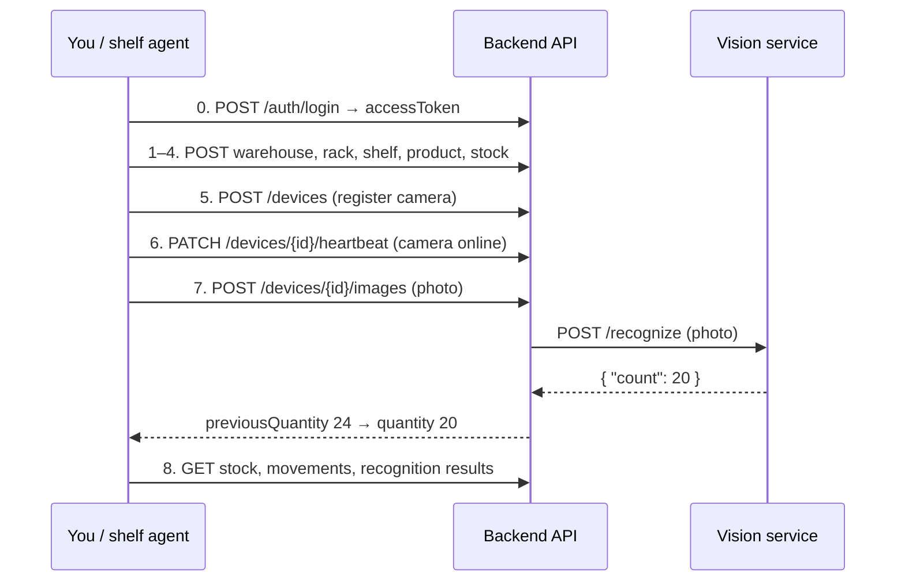

# Tutorial: connect a shelf camera and update stock from a photo

**Goal:** set up a shelf with stock, register a camera for it, upload a shelf photo and see the backend count the items, correct the stock and log the change. This is exactly what the Raspberry Pi shelf agent ([`Device/`](../../../Device/README.md)) does. Here you do each call by hand.

**Time:** 15 minutes. **You need:** the backend running with the Vision service ([Getting Started, step 2](../GETTING_STARTED.md#2-start-the-backend)), `curl`, and any shelf photo (`shelf.jpg`; the demo photos in `Device/scenarios/demo/images/` work).

## Step 0. Get an access token

Every call below needs a JWT. Register and sign in as in [Getting Started, step 3](../GETTING_STARTED.md#3-get-an-access-token) and keep the token in `$TOKEN`:

```bash
TOKEN=$(curl -s -X POST http://localhost:8080/auth/login -H "Content-Type: application/json" \
  -d '{"username": "anna", "password": "S3cure-passw0rd"}' | sed -E 's/.*"accessToken":"([^"]+)".*/\1/')
```

The token expires after 15 minutes. If a call suddenly returns `401` with an empty body, run the line above again.

The responses below were captured from a real run on an empty database. If your database already has data, IDs will differ: use the IDs your calls return.



## Step 1. Create the warehouse and a rack

```bash
curl -X POST http://localhost:8080/warehouses -H "Authorization: Bearer $TOKEN" -H "Content-Type: application/json" \
  -d '{"name": "Central warehouse", "address": "Gedimino pr. 1, Vilnius"}'
# 1
```

A rack is created **under** its warehouse (the ID in the path):

```bash
curl -X POST http://localhost:8080/racks/warehouse/1 -H "Authorization: Bearer $TOKEN" -H "Content-Type: application/json" \
  -d '{"label": "A", "warehouseId": 1}'
# 1
```

## Step 2. Create a shelf on the rack

```bash
curl -X POST http://localhost:8080/shelves -H "Authorization: Bearer $TOKEN" -H "Content-Type: application/json" \
  -d '{"label": "A-1", "capacity": 120, "rackId": 1}'
# 1
```

`capacity` must be positive. With `"rackId": 99` you get `404 {"status":404,"message":"Rack with id 99 is not found"}`.

## Step 3. Add the product

```bash
curl -X POST http://localhost:8080/products -H "Authorization: Bearer $TOKEN" -H "Content-Type: application/json" \
  -d '{"sku": "SKU-1001", "name": "Milk 1L", "description": "UHT milk 3.2%, 1 litre carton"}'
# 1
```

## Step 4. Put stock on the shelf

Record that shelf A-1 holds 24 cartons:

```bash
curl -X POST http://localhost:8080/shelf-stock -H "Authorization: Bearer $TOKEN" -H "Content-Type: application/json" \
  -d '{"shelfId": 1, "productId": 1, "quantity": 24, "expirationDate": "2026-12-20"}'
# 1
```

> **Important:** camera processing needs **exactly one** stock record on the shelf (one product per shelf). With zero or several records the photo upload returns `409 Camera processing requires exactly one stock record on the shelf`.

Check the total for the SKU:

```bash
curl "http://localhost:8080/stocks?sku=SKU-1001" -H "Authorization: Bearer $TOKEN"
```

```json
[{ "productSKU": "SKU-1001", "productRemains": 24 }]
```

## Step 5. Register the camera

The `deviceKey` is the name the camera uses; the shelf agent has the same value in its config.

```bash
curl -X POST http://localhost:8080/devices -H "Authorization: Bearer $TOKEN" -H "Content-Type: application/json" \
  -d '{"deviceKey": "shelf-a1-cam", "shelfId": 1}'
# 1
```

```bash
curl http://localhost:8080/devices/1 -H "Authorization: Bearer $TOKEN"
```

```json
{ "id": 1, "deviceKey": "shelf-a1-cam", "status": "INACTIVE", "lastSeenAt": null, "shelfId": 1 }
```

A new camera is `INACTIVE` and has never been seen. Registering the same key again returns `409 Device with key shelf-a1-cam already exists`.

## Step 6. Bring the camera online

The shelf agent sends a heartbeat when it starts and then periodically. The first heartbeat makes the device `ACTIVE`:

```bash
curl -i -X PATCH http://localhost:8080/devices/1/heartbeat -H "Authorization: Bearer $TOKEN"
# HTTP/1.1 204
```

(An administrator can do the same with `PATCH /devices/1/activate`.) Photos from an `INACTIVE` camera are rejected with `409 Device is inactive`.

## Step 7. Upload a shelf photo

This is the main integration call. Send the photo as `multipart/form-data` (field `file`) and say when it was taken:

```bash
curl -X POST "http://localhost:8080/devices/1/images?capturedAt=2026-11-23T10:15:00" -H "Authorization: Bearer $TOKEN" \
  -F "file=@shelf.jpg;type=image/jpeg"
```

```json
{
  "imageEventId": 1,
  "recognitionResultId": 1,
  "shelfId": 1,
  "previousQuantity": 24,
  "quantity": 20,
  "quantityDelta": -4
}
```

The Vision service counted **20** cartons. The shelf had 24, so 4 were taken. In one transaction the backend saved the photo, recorded the recognition and set the stock to 20.

Upload the same photo again with the same `capturedAt` and you get `409 An image with the same or a later capture time was already processed`. Photos must arrive in capture order, which protects the stock from late or duplicate uploads (the shelf agent retries from its outbox).

## Step 8. See the result

**Stock** is now 20:

```bash
curl http://localhost:8080/shelf-stock/shelf/1 -H "Authorization: Bearer $TOKEN"
```

```json
[{ "id": 1, "shelfId": 1, "productId": 1, "quantity": 20, "expirationDate": "2026-12-20", "status": "ACTIVE" }]
```

**The change is logged** as a camera adjustment:

```bash
curl http://localhost:8080/stock-movements/shelf/1 -H "Authorization: Bearer $TOKEN"
```

```json
[{ "id": 1, "productId": 1, "shelfId": 1, "quantityDelta": -4, "type": "ADJUSTMENT", "source": "CAMERA", "createdAt": "2026-11-23T22:38:47.579663" }]
```

**What the camera saw:**

```bash
curl http://localhost:8080/recognition-results/image-event/1 -H "Authorization: Bearer $TOKEN"
```

```json
[{ "id": 1, "imageEventId": 1, "productId": 1, "detectedQuantity": 20, "quantityDelta": -4, "confidence": null, "status": "CONFIRMED" }]
```

**The camera is online** (`lastSeenAt` updated by the upload):

```bash
curl http://localhost:8080/devices/1 -H "Authorization: Bearer $TOKEN"
```

```json
{ "id": 1, "deviceKey": "shelf-a1-cam", "status": "ACTIVE", "lastSeenAt": "2026-11-23T22:38:47.485626", "shelfId": 1 }
```

## Step 9 (optional). Let the real shelf agent do it

Steps 6–7 are what the shelf agent automates: heartbeats, photos on a trigger, and an outbox that retries uploads in capture order.

> **Known gap:** the shelf agent does not send an access token yet, so against a backend with authentication its heartbeats and uploads get `401`. Until device authentication lands, use the manual calls above (or the agent's built-in mock server, `python -m shelf_agent mock-server`) to see the flow.

- **On a PC (no camera):** the emulator registers its devices and uploads the demo photos for the shelves in a scenario:

  ```bash
  cd Device
  pip install -r requirements.txt
  python -m shelf_agent emulate --scenario scenarios/demo/scenario.toml
  ```

- **On the Raspberry Pi:** set `base_url = "http://<backend-host>:8080"` in the agent config, then start it with the device key from step 5:

  ```bash
  SW_DEVICE_KEY=shelf-a1-cam python -m shelf_agent run --config /etc/shelf-agent/device.toml
  ```

Details: [Device/README.md](../../../Device/README.md#against-the-real-backend).

## Troubleshooting

| Response | Cause | Fix |
|---|---|---|
| `401` with an empty body | No `Authorization` header, or the token expired (15 minutes) | Step 0: sign in again and resend with `-H "Authorization: Bearer $TOKEN"` |
| `404 Device not found: 1` | Wrong device ID in the upload path | Use the ID from step 5 (`GET /devices`) |
| `409 Device is inactive` | No heartbeat yet, or the camera was deactivated | `PATCH /devices/{id}/heartbeat` or `/activate` |
| `409 Camera processing requires exactly one stock record on the shelf` | The shelf has no stock record or several | Step 4: exactly one `shelf-stock` record per shelf |
| `409 An image with the same or a later capture time was already processed` | Duplicate or out-of-order photo | Send a later `capturedAt` |
| `415 Content-Type 'application/json' is not supported.` | Photo not sent as multipart | Use `-F "file=@…"` |
| `400 Required parameter 'capturedAt' is not present.` | Query parameter missing | Add `?capturedAt=YYYY-MM-DDThh:mm:ss` |
| `502 Vision service request failed` | Vision service not running or unreachable | `docker compose ps vision`; check `VISION_BASE_URL` |
| `500` on `POST /devices` | Known issue: the shelf already has a camera (should be 409) | Use another shelf or deactivate/delete the old device |
