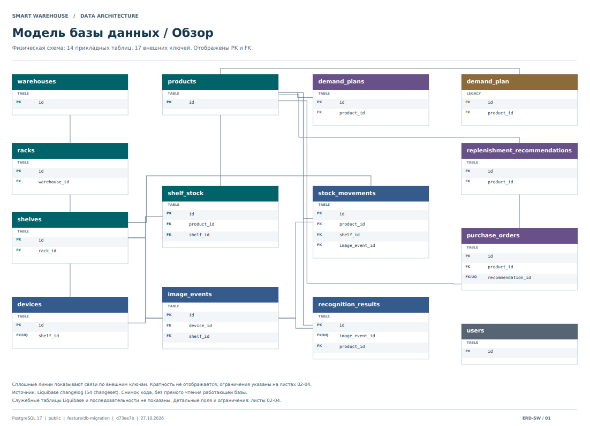
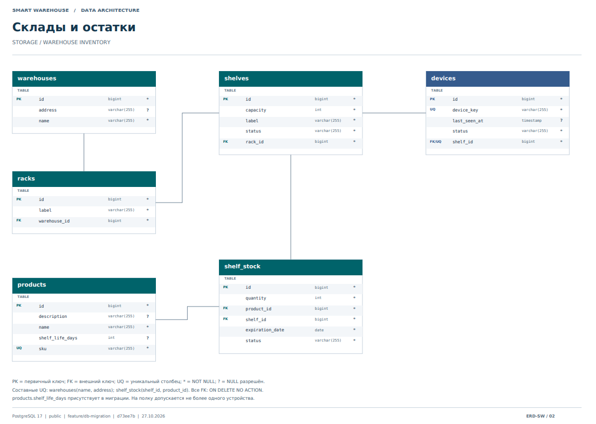
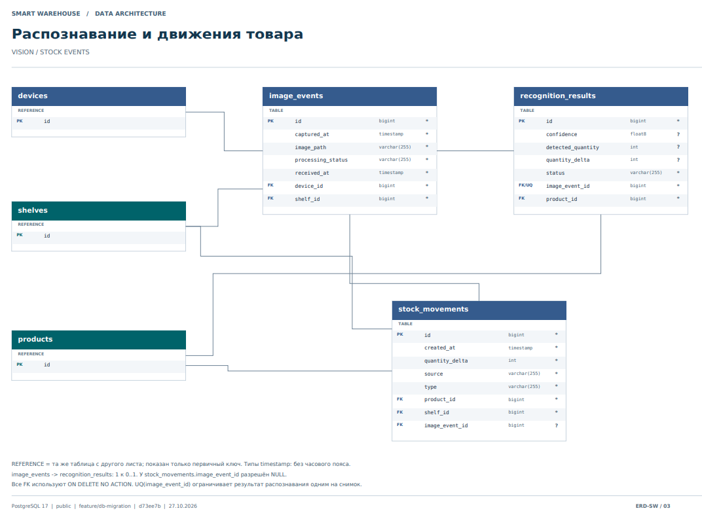
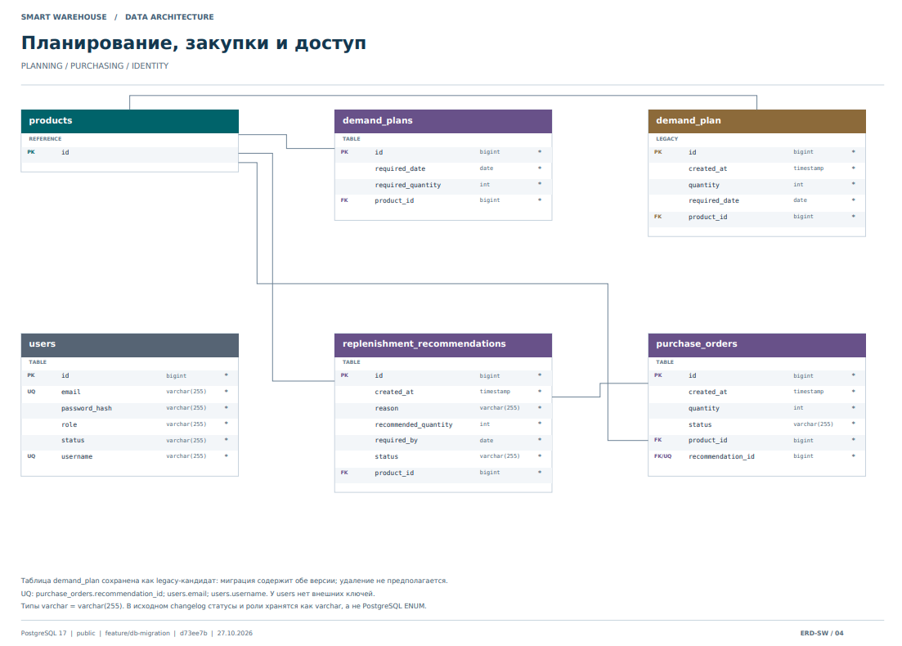

# Database schema

## General scheme

The diagram shows how the database organizes warehouse inventory, product
recognition, stock movements, demand planning, and procurement.

## Warehouses and remnants

A warehouse contains racks, and each rack contains shelves. Stock records track
the quantity of each product on a shelf.

## Product recognition and movement

Image events record photos received from shelf devices. Recognition results
store the outcome of processing those images, while stock movements record
changes in inventory.

## Planning and Procurement

Demand plans record expected product needs. Replenishment recommendations
suggest quantities to order, and purchase orders record planned purchases.

