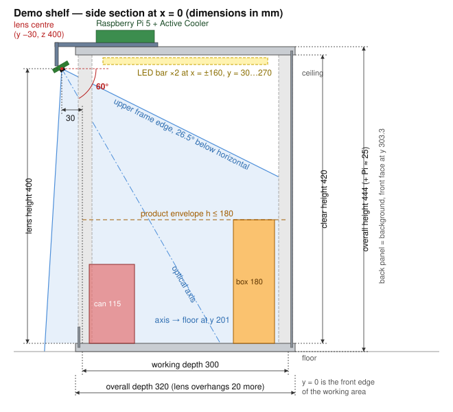
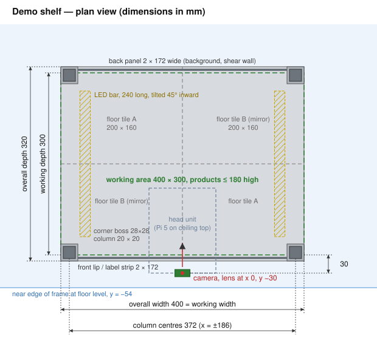

# Shelf device: demo shelf module

Hardware design of the camera shelf used to demonstrate the system: one standard shelf module with a Raspberry Pi 5, a camera and a flash light that turns on only while a photo is taken. The module is 3D-printed, comes apart by hand (thumb screws, keys and grooves; the head unit with the electronics travels assembled) and packs into a shoebox-sized carton, so it can be carried to the diploma defence and assembled there in a few minutes.

It is the physical counterpart of the *Shelf device* role and FR-04/FR-05 in [PROJECT_DOCUMENTATION.md](../PROJECT_DOCUMENTATION.md), the "optional physical camera/controller prototype" in Milestone 4 of [MILESTONES.md](../MILESTONES.md), and the device side of [RFC-0001](../rfcs/0001-image-ingestion-and-recognition-pipeline.md).

All optical numbers below come from [shelf_fov.py](shelf_fov.py). If you change the shelf size, the product height or the camera, re-run the script (see [Changing the standard](#11-changing-the-standard)) and update this document in the same PR.

## 1. Key numbers

| Parameter | Value |
|---|---|
| Working area (where products stand) | **400 × 300 mm** (W × D), one layer, products up to **180 mm** high |
| Overall module size | 400 × 320 × 444 mm (W × D × H), plus the Pi on top (≈ 25 mm) and the camera overhanging 20 mm at the front |
| Clear height (floor to ceiling) | 420 mm |
| Camera | Raspberry Pi Camera Module 3 **Wide** (IMX708, 12 MP, 102° × 67°, autofocus) |
| Lens position | centred (x = 0), **30 mm in front of** the front edge of the working area, **400 mm above** the floor |
| Camera tilt | **60° below horizontal** (optical axis 30° from vertical, looking into the shelf) |
| Allowed assembly error | pitch 53.8–65.8°, lens height 360–795 mm, lens y −116…+8 mm (each one separately); ±3°, ±10 mm, ±10 mm all at once |
| Image detail | 3.6 px/mm at the far floor corners, up to 9 px/mm on tops of front products (full resolution 4608 × 2592) |
| Focus | fixed, 0.38 m (`LensPosition` = 2.63 dioptres) |
| Light | 2 × 240 mm 5 V COB LED bars under the ceiling, ≈ 5 W, switched by GPIO17 through a MOSFET |
| Controller | Raspberry Pi 5 (4 GB) + Active Cooler, official 27 W USB-C supply — **one** mains plug for everything |
| Print | PETG, ≈ 1.9 kg, all parts fit a 220 × 220 mm bed |

## 2. Requirements

1. Every product placed in one layer anywhere in the working area is fully inside the frame, including its top face, with a 5 % free border at each edge of the image (lens distortion and assembly error eat into that border, not into the shelf).
2. The geometry imitates a real rack: the camera hangs under the shelf above, so the module has a realistic clear height (300–450 mm is common in warehouse racks), not a tall camera mast.
3. Lighting is controlled: the photo is taken under the module's own light, which is on only while capturing, so the images look the same in a dark lab and in a bright auditorium.
4. 3D-printable on a common printer (bed ≥ 220 × 220 mm), no parts that need machining.
5. Assembles and disassembles by hand, survives transport, and keeps camera alignment after reassembly (fixed, keyed geometry — no adjustment screws to re-tune on site).
6. Standard, off-the-shelf electronics that work with Raspberry Pi OS out of the box.

## 3. Components

### 3.1 Camera choice

The camera has to see a 400 mm wide shelf from very close. What decides the height of the whole module is the horizontal field of view: the front corners of the shelf are right below the camera and far to the side. Minimum lens height for the same 400 × 300 × 180 mm working volume (lens 30 mm in front of the shelf, 5 % frame margin):

| Camera | FOV (H × V) | Focus | Minimum lens height | Verdict |
|---|---|---|---|---|
| **Camera Module 3 Wide** (IMX708) | 102° × 67° | auto, 5 cm – ∞ | **360 mm** | **chosen** |
| Camera Module 3 (IMX708) | 66° × 41° | auto, 10 cm – ∞ | 550 mm | module 40 % taller, no longer looks like a rack shelf |
| Camera Module v2 (IMX219) | 62° × 49° | fixed, factory-set far | 540 mm | tall, and the fixed lens must be refocused by hand to 0.4 m |
| OV5647 5 MP clones | 54° × 41° | fixed | 610 mm | tallest, weaker image tuning, focus by hand |

The Camera Module 3 Wide is an official Raspberry Pi part: it is detected automatically on Raspberry Pi OS (Bookworm), has a tuned libcamera profile and is driven by Picamera2 without extra drivers. The wide lens has visible barrel distortion near the image edges; this is removed in software with a one-time calibration (section 9) and is already covered by the frame margin. Use the normal version, **not NoIR** — the NoIR variant has no infrared filter and shifts colours under mixed light.

### 3.2 Bill of materials — electronics

| # | Item | Qty | Notes |
|---|---|---|---|
| 1 | Raspberry Pi 5, 4 GB | 1 | 2 GB is enough for capture + upload; 4 GB leaves room for on-device undistortion at 12 MP |
| 2 | Raspberry Pi 27 W USB-C power supply (5.1 V / 5 A) | 1 | Needed so the Pi can feed the LEDs from its 5 V rail (section 7.3) |
| 3 | Raspberry Pi Active Cooler | 1 | The Pi sits under a closed ceiling; without the cooler it throttles |
| 4 | microSD card 32 GB, A2 class | 1 | Raspberry Pi branded or SanDisk Extreme |
| 5 | Raspberry Pi Camera Module 3 **Wide** | 1 | Not NoIR |
| 6 | Raspberry Pi 5 camera cable, "standard – mini", **300 mm** | 1 | The camera has a 15-pin 1 mm connector, the Pi 5 a 22-pin 0.5 mm one; the cable that comes with the camera does **not** fit the Pi 5 |
| 7 | 5 V COB LED strip, 8 mm, 4000 K, CRI ≥ 90, ≈ 10 W/m | 0.5 m | Neutral white and high CRI keep product colours true; COB gives an even line without hot spots |
| 8 | Aluminium LED channel ≈ 17 × 8 mm with opal (milky) diffuser + end caps | 2 × 250 mm | Cut from a 1 m profile; the diffuser removes glare on glossy packaging |
| 9 | Logic-level N-MOSFET IRLZ44N (TO-220) | 1 | Fully on at 3.3 V gate drive for a 1 A load |
| 10 | Resistors 100 Ω and 10 kΩ, 0.25 W | 1 + 1 | Gate resistor and gate pull-down |
| 11 | Resettable fuse (PTC), 1.35 A hold, e.g. MF-R135 | 1 | Protects the Pi's 5 V rail if an LED wire shorts |
| 12 | Electrolytic capacitor 470 µF, 16 V | 1 | Softens the 5 V rail dip when the LEDs switch on |
| 13 | Perfboard 30 × 40 mm, JST-XH 2-pin plug + socket pairs, Dupont female jumpers | 1, 2, 5 | LED bars unplug for transport |
| 14 | Wire 0.35 mm² (22 AWG), red/black | 1.5 m | |
| 15 | Tactile push button 12 mm (optional) | 1 | "Take a photo now" button for the demo |

### 3.3 Bill of materials — fasteners

| Item | Qty | Used for |
|---|---|---|
| M3 heat-set insert, 4–5 mm long | 8 | Column lock screws in the corner bosses |
| M3 × 10 screw + printed thumb knob (or a ready-made M3 thumb screw) | 8 | Locking columns in the bosses |
| M3 × 10 screw + M3 nut | 8 | Head unit (4) and LED clips (4) to the ceiling grid |
| M2.5 × 10 standoff + M2.5 × 6 screw | 4 + 8 | Raspberry Pi 5 on the head unit |
| M2 × 6 screw + M2 nut | 4 | Camera board on its bracket |

## 4. Optical geometry



### 4.1 Coordinate system

All dimensions use one frame of reference:

- **x** — across the shelf, 0 on the centre line;
- **y** — into the shelf, 0 at the **front edge of the working area**, positive towards the back;
- **z** — up, 0 at the **top surface of the floor**.

### 4.2 Camera placement

- The **lens centre** (not the board centre) is at **x = 0, y = −30 mm, z = 400 mm**.
- The camera looks into the shelf, tilted **60° below horizontal**. The camera board plane is therefore 30° from horizontal, facing down and back.
- The sensor's long side is parallel to the shelf front (landscape across the width).
- The optical axis meets the floor at y = 201 mm — behind the middle of the shelf, because the back of the shelf is further away and needs more of the frame.
- The upper edge of the frame is 26.5° below horizontal, so every ray from the lens goes downward: nothing above the lens (ceiling, LED bars, head unit) can appear in the image or shine straight into the lens. At the back panel the frame ends 234 mm above the floor, so the back panel is the image background.
- The lower edge of the frame goes slightly forward and meets floor level at y = −54 mm, so the front lip and the bottoms of front-row products are in the picture.

### 4.3 Why these numbers

Lens height 400 mm is the minimum (360 mm) plus 40 mm of reserve. With the lens at 360 mm only a 1° window of pitch works; at 400 mm the whole volume stays in the frame for any pitch from 53.8° to 65.8°. 60° is the middle of that window, so a print or assembly error of a few degrees cannot cut off a corner of the shelf. The 30 mm overhang in front of the shelf is what makes the front corners visible: with the lens directly above the front edge the module would need to be about 10 mm taller for the same reserve, and with the lens more than 8 mm behind the front edge the front row drops out of the frame.

### 4.4 Image coverage and detail

Computed for full resolution 4608 × 2592 (`python shelf_fov.py`); u, v are pixel coordinates with (0, 0) at the top left; *elevation* is how steeply the camera looks down at that point.

| Point (x, y, z), mm | Pixel (u, v) | Distance, mm | Elevation | Detail, px/mm |
|---|---|---|---|---|
| Front corner, floor (−200, 0, 0) | 1272, 2239 | 448 | 63° | 5.2 |
| Front corner, product top (−200, 0, 180) | 488, 2096 | 299 | 47° | 9.1 |
| Middle edge, floor (−200, 150, 0) | 1449, 1494 | 482 | 56° | 4.3 |
| Back corner, floor (−200, 300, 0) | 1574, 968 | 556 | 46° | 3.6 |
| Back corner, product top (−200, 300, 180) | 1254, 328 | 444 | 30° | 5.2 |
| Centre of back edge, product top (0, 300, 180) | 2304, 328 | 397 | 34° | 5.2 |

The worst case, 3.6 px/mm, still puts ≈ 240 px across a 66 mm can. A recognition model that runs at 640 px input gets more than enough detail from a downscaled frame; full resolution is kept for archiving and for cropping single products.

### 4.5 Focus

The working volume is 0.22–0.56 m from the lens. Autofocus is not used during capture (it would hunt and add delay); instead the lens is set once to **0.38 m** (`LensPosition = 2.63` dioptres). With a blur of at most 2 px at full resolution everything from 0.29 to 0.55 m is sharp; at the 2× downscaled resolution the model sees, everything from 0.24 to 1.0 m is sharp, i.e. the whole volume.

### 4.6 Placement rules for products (single layer)

- One layer only, nothing stacked; height ≤ 180 mm.
- Keep the corner zones free: the column bosses take 28 × 18 mm in each corner of the working area.
- The tops of products of equal height never hide each other. A **taller** product in front of a shorter one hides part of it: a height difference Δh hides a strip of length Δh / tan(e) behind it, where e is the elevation in the table above (≈ 80° at the front row, ≈ 55° in the middle, ≈ 30–45° at the back). Example: a 180 mm box in front of a 115 mm can in the middle of the shelf hides 65 / tan 55° ≈ 45 mm behind it. Rule: **taller products at the back**.
- Leave ≥ 10 mm between products — it makes them easier to separate in the image.
- The front faces of products in the back half are seen at 30–45°, so labels there are readable; front-row products are seen almost from above, so recognition there relies on the top face.

## 5. Mechanical design



### 5.1 Concept

The module is a box with an open front and open sides, built from a small kit of printed parts:

- **floor** and **ceiling** — each made of four 200 × 160 mm tiles;
- **four columns** at the corners, each made of two 220 mm tube segments;
- a **back panel**, which is the image background and the shear wall that keeps the box square;
- a **front lip** that stops products from sliding off and holds the shelf ID label;
- a **head unit** on top of the ceiling carrying the Raspberry Pi and the camera bracket;
- two **LED bars** under the ceiling along the left and right sides.

Tiles are joined by printed bow-tie keys pressed in from the rib side, columns push into square sockets, panels slide into grooves. Thumb screws lock the columns; the only screwdriver job on site is the four screws of the head unit. All parts locate on fixed features (sockets, grooves, keys), so after reassembly the camera ends up in the same place within a few millimetres — well inside the tolerances of section 1.

### 5.2 Vertical stack

| z, mm | Element |
|---|---|
| −12 … 0 | Floor tiles (3 mm deck on top, ribs below, standing on the table) |
| −10 … +15 | Floor socket for the column (boss rises 15 mm above the deck) |
| 0 | Floor top surface = reference plane |
| −6 … 0 | Grooves for the back panel and front lip |
| ≤ 180 | Products |
| 400 | Lens centre |
| 405 … 430 | Ceiling socket for the column (boss hangs 15 mm below the deck) |
| 405 … 418 | LED bars |
| 420 | Ceiling underside |
| 420 … 432 | Ceiling tiles (3 mm deck at the bottom, ribs above) |
| 432 … ≈ 460 | Head unit plate, Raspberry Pi 5 with Active Cooler |

### 5.3 Printed parts

| ID | Part | Qty | Size, mm | Details |
|---|---|---|---|---|
| P1 | Floor tile | 2 + 2 mirrored | 200 × 160 × 12 | 3 mm deck, 8 mm rail on all four edges, 2 mm ribs at 40 mm pitch below. At the outer corner a 28 × 28 mm boss rising 15 mm above the deck, with a 20.4 × 20.4 mm socket 25 mm deep. Along the outer 200 mm edge a 3.4 mm wide, 6 mm deep groove, centred 5 mm from the edge. Two bow-tie pockets on each inner edge. Engraved 0.4 mm line marking the working area. Mirror two of them in the slicer. |
| P2 | Ceiling tile | 2 + 2 mirrored | 200 × 160 × 12 | Same as P1, mounted upside down (deck down, boss hanging down), plus a grid of Ø 3.4 mm holes at 20 mm pitch through the deck for mounting anything anywhere. |
| P3 | Column segment | 8 | 20 × 20 × 220 | Square tube, 2.4 mm wall (inside 15.2 × 15.2). One column = two segments, total 440 mm, from z = −10 to z = 430. |
| P4 | Column coupler | 4 | 14.8 × 14.8 × 40 | Solid; 20 mm goes into each segment. |
| P5 | Back panel | 4 | 172 × 215 × 3 | Two wide × two high, front face at y = 303.3. Bottom edge sits in the floor groove, top edge in the ceiling groove (2 mm vertical play). 5 mm ribs on the rear side, stopping 8 mm short of the edges; eight bow-tie keys on the rear join the four pieces. |
| P6 | Front lip / label strip | 2 | 172 × 30 × 3 | Sits in the front floor groove, 24 mm above the floor. Holds the printed shelf label (shelf ID and QR code). Does not block the camera: the lowest ray passes 66 mm above it. |
| P7 | Bow-tie key | 24 + 4 spare | 30 × 16 × 6, 8 mm waist | 8 for the floor, 8 for the ceiling, 8 for the back panel. |
| P8 | Head unit | 1 | 110 × 150 × 4 plate + front arm | Sits on the ceiling ribs at x −55…55, y −40…110, bolted with 4 × M3 to both front ceiling tiles (also splices the front seam). M2.5 standoffs for the Pi (58 × 49 mm pattern), place for the 30 × 40 mm perfboard and the button. The front arm goes down over the ceiling edge to the camera bracket. |
| P9 | Camera bracket | 1 | ≈ 35 × 30 × 15 | Holds the camera board at a fixed 30° to horizontal (axis 60° below horizontal), lens centre at y = −30, z = 400. M2 holes on the camera's 21 × 12.5 mm pattern. Fixed angle on purpose — nothing to knock out of alignment. |
| P10 | LED channel clip | 4 | ≈ 25 × 20 × 15 | Cradle holding the aluminium channel at 45°, facing the centre of the shelf. Two per bar, at y = 50 and y = 250, x = ±160; M3 into the ceiling grid. |
| P11 | Thumb knob | 8 | Ø 20 | Press-fit on M3 × 10 screws (optional — plain screws work too). |

Fit tolerances (tune with a test print of one socket and one key before printing everything): sockets and grooves +0.4 mm over the mating part, bow-tie keys −0.15 mm per side, column coupler −0.2 mm per side.

### 5.4 Printing

- **Material:** PETG for all structural parts. PLA prints more easily but softens in a hot car (≈ 55 °C) and creeps under the screws; that matters for something that travels.
- **Colour:** floor tiles (P1), back panel (P5) and front lip (P6) in **matte light grey** — a neutral, non-glossy background makes products easy to separate and does not fool white balance. Other parts in any colour.
- **Surface:** print P1 and P5 deck-down on a textured PEI sheet; the textured bed side becomes the visible surface and is naturally matte.
- **Settings:** 0.4 mm nozzle, 0.2 mm layers, 3 perimeters (4 for P3), 20 % gyroid infill. Columns (P3) are printed lying on a side so the layers run along the column — much stiffer in bending than printed upright.
- **Bed:** the largest parts are P5 (172 × 215 mm), P1/P2 (200 × 160 mm) and P3 (220 mm long, fits diagonally) — any printer with a 220 × 220 mm bed works (Ender-3 class, Prusa MK4, Bambu A1/P1).
- **Budget (estimate):** ≈ 1.9 kg of PETG, ≈ 60–70 printing hours.

## 6. Lighting

- **Where:** two LED bars under the ceiling, along the left and right sides (x = ±160, y = 30…270), tilted 45° towards the centre. Light from the sides is not reflected straight back into a camera that looks from the front, so glossy packaging shows less glare than with a light next to the lens. The bars are above the lens, so they are never in the frame.
- **What:** 5 V COB strip, 4000 K, CRI ≥ 90, in an aluminium channel with an opal diffuser. 2 × 240 mm at ≈ 10 W/m is ≈ 5 W, ≈ 1.0 A.
- **How bright (estimate, check with a lux-meter app):** roughly 1500–3000 lx on the floor, several times typical room lighting (300–500 lx). Together with fixed exposure (section 8) this keeps images consistent regardless of the room.
- **When:** on only for the capture (≈ 0.3–0.5 s per photo), so the strip and the Pi's power rail never get warm. Plain DC through a MOSFET, no PWM, so there is no flicker or banding with the rolling-shutter sensor.

## 7. Electrical

### 7.1 Wiring

| From (Pi 5 header) | Through | To |
|---|---|---|
| Pin 2 and pin 4 (5 V) | PTC fuse 1.35 A | LED bars "+" (both bars in parallel), C 470 µF "+" |
| Pin 6 (GND) | — | MOSFET source, C 470 µF "−" |
| Pin 11 (GPIO17) | 100 Ω | MOSFET gate; 10 kΩ from gate to GND keeps the light off while the Pi boots |
| MOSFET drain | — | LED bars "−" |
| Pin 13 (GPIO27) | push button | Pin 14 (GND); internal pull-up in software |
| CAM/DISP 0 connector | 300 mm standard–mini cable | Camera Module 3 Wide |

```text
 Pi 5V (pins 2+4) ──[PTC 1.35A]──┬───────────────► LED bars +  (JST-XH, ×2 in parallel)
                                 │
                               [470µF]
                                 │                 LED bars −
 Pi GND (pin 6) ─────────────────┴──────┐              │
                                        │          D ┌─┘
 Pi GPIO17 (pin 11) ──[100Ω]──┬─────────┼──────── G ─┤  IRLZ44N
                              │         │          S └─┐
                            [10k]       │              │
                              │         │              │
                              └─────────┴──────────────┘ GND
```

### 7.2 Layout

The perfboard with the MOSFET, PTC, capacitor and resistors sits on the head unit next to the Pi and connects to the header with Dupont jumpers. LED wires go up through grid holes near the back of each bar (y ≈ 270), run on top of the ceiling and end in JST-XH plugs on the perfboard, so the bars unplug for transport. The camera stays connected to the Pi: the camera and the Pi travel together on the head unit, so the fragile ribbon connectors are not plugged and unplugged at every setup.

### 7.3 Power budget

| Load | Current at 5 V |
|---|---|
| Raspberry Pi 5, capture + upload (peak under full CPU load) | ≤ 2.5 A |
| Camera Module 3 Wide | ≈ 0.3 A |
| LED bars (only during capture) | ≈ 1.0 A |
| **Total, worst case** | **≈ 3.8 A** of the 5 A the 27 W supply provides |

With the 27 W supply the Pi 5 allows up to 1.6 A for peripherals on USB; no USB devices are connected here, so that headroom goes to the LEDs on the header 5 V pins instead. Do **not** use a 3 A (15 W) supply with this wiring — use the official 27 W one. With one mains plug for the whole module, setup at the defence is "plug in, wait for boot".

## 8. Software

Reference capture sequence for the device (the device application itself belongs with the firmware/simulator work of Milestone 4). Raspberry Pi OS Bookworm 64-bit has `picamera2` and `gpiozero` preinstalled (`sudo apt install python3-picamera2 python3-gpiozero` on the Lite image); the Camera Module 3 is detected automatically.

```python
from time import sleep

from gpiozero import LED
from libcamera import Transform, controls
from picamera2 import Picamera2

light = LED(17)
camera = Picamera2()
camera.configure(camera.create_still_configuration(
    main={"size": (4608, 2592)},
    transform=Transform(hflip=False, vflip=False),  # set both True if the first image is upside down
))
camera.set_controls({
    "AfMode": controls.AfModeEnum.Manual,
    "LensPosition": 2.63,         # 0.38 m, see section 4.5
    "AeEnable": False,
    "ExposureTime": 10_000,       # µs, starting value — tune in calibration
    "AnalogueGain": 2.0,          # starting value — tune in calibration
    "AwbEnable": False,
    "ColourGains": (2.0, 1.8),    # replace with values from calibration
})
camera.start()


def capture(path: str) -> None:
    light.on()
    sleep(0.3)  # let the sensor finish frames that started before the light was on
    camera.capture_file(path)
    light.off()
```

After capture the device uploads the image with `shelfId`, `deviceId` and `capturedAt` as described in [RFC-0001](../rfcs/0001-image-ingestion-and-recognition-pipeline.md). Trigger options for the demo: the button on GPIO27, a fixed interval (e.g. every 30 s), or a request from the backend. Detecting the moment goods are added or removed (load cells under the floor, motion detection on low-resolution frames) is out of scope for this document.

## 9. Calibration after assembly

Done once after the first assembly, results saved on the device (e.g. `/etc/smart-shelf/calibration.json`). A reassembly only needs the quick check in step 5.

1. **Orientation.** Take a photo; if it is upside down, set `hflip` and `vflip` to `True`.
2. **Focus.** Put a printed page with small text in the middle and at the back of the shelf, compare sharpness for `LensPosition` 2.3–3.0 and keep the best value (expected ≈ 2.6).
3. **Exposure and colour.** With the LEDs on and a grey card (or plain white paper) on the floor, run once with auto exposure and auto white balance, read `ExposureTime`, `AnalogueGain` and `ColourGains` from the capture metadata, and fix those values. Check that the histogram is not clipped on the brightest packaging.
4. **Lens distortion.** Photograph an A4 checkerboard (9 × 6 squares of 25 mm) in 15–20 positions across the shelf and compute the camera matrix and distortion coefficients with OpenCV `calibrateCamera`. Images are undistorted before recognition.
5. **Shelf position in the image.** Stick four 20 mm ArUco markers (`DICT_4X4_50`, ids 0–3) on top of the four corner bosses. From them the software finds the working area in every image (for cropping or a top-down rectified view) and notices if the camera was bumped — markers moved by more than a few pixels between photos means "check the assembly".

## 10. Assembly, transport and demo

### 10.1 Assembly (≈ 10 minutes)

1. Lay the four floor tiles deck-down, press in 8 bow-tie keys, turn the floor over.
2. Join the column segments with couplers, push the four columns into the floor sockets, tighten the lower thumb screws.
3. Slide the two lower back panels and the front lip into the floor grooves; put the two upper back panels on top and key the four panels together from behind.
4. Join the four ceiling tiles with 8 keys, lower the ceiling onto the columns and the top edge of the back panel, tighten the upper thumb screws.
5. Put the head unit on the ceiling, 4 × M3. Plug in the two LED bars (already mounted on the ceiling in their clips).
6. Plug in the 27 W supply, wait for boot, take a test photo and check the ArUco markers (section 9, step 5).

Disassembly is the reverse. The LED bars may stay on the ceiling tiles.

### 10.2 Packing

| Package | Contents | Approx. size |
|---|---|---|
| Carton 1 | 8 tiles (stacked), 4 back panels, 2 front lips, 8 column segments, couplers, keys, spare keys | 240 × 220 × 200 mm, ≈ 2 kg |
| Carton 2 (padded) | Head unit with Raspberry Pi, camera and cable attached, power supply, spare microSD with a copy of the image | small box |

Bring: a set of 5–10 demo products that fit the 180 mm envelope (e.g. 330 ml cans, tea boxes, 200 ml juice packs), the printed shelf label, and a 5 V/5 A spare supply if possible.

## 11. Changing the standard

The module is defined by four inputs: working width, working depth, maximum product height and camera. The geometry for any other combination comes from the script:

```bash
python Documentation/hardware/shelf_fov.py --width 600 --depth 300 --height 180
```

It prints the minimum lens height for each supported camera, checks the chosen position and tilt, and shows the pixel detail and focus range. Wider shelves need a higher camera (or two cameras side by side, each covering half); a deeper shelf mostly needs a flatter tilt. Keep the lens in front of the shelf and above the products, and keep the free frame margin at 5 % or more.

## 12. Open items

- CAD model and STL files for parts P1–P11, built from the dimensions in this document.
- Device application (capture, upload, retries, device authentication) as part of Milestone 4.
- Measured illuminance and the final exposure/colour values after the first assembly.
