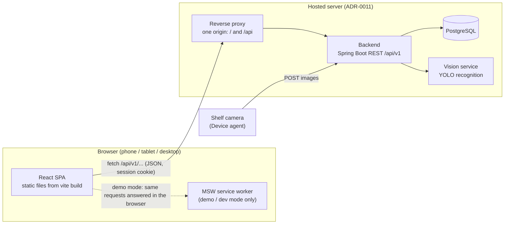
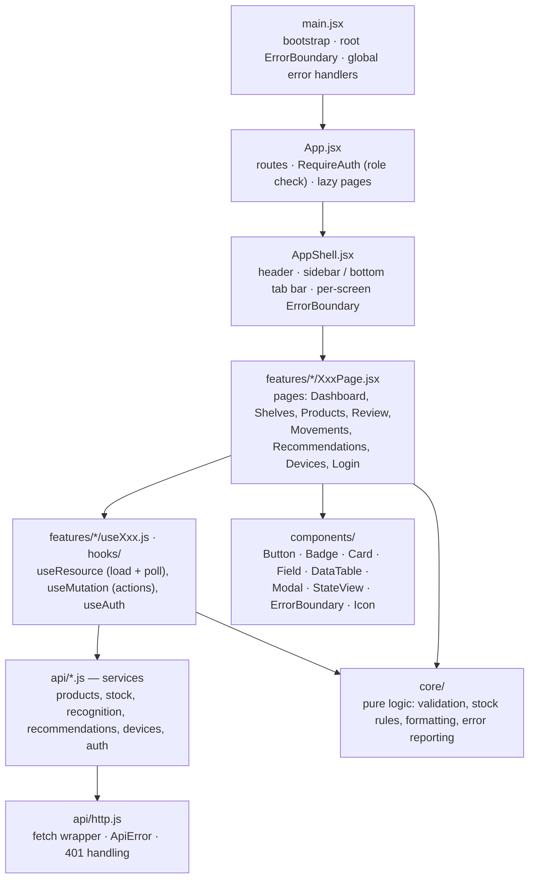
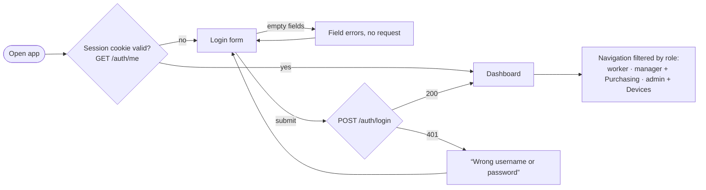
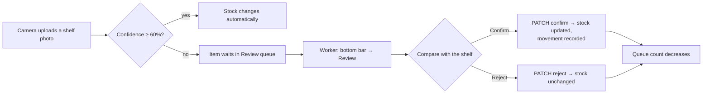
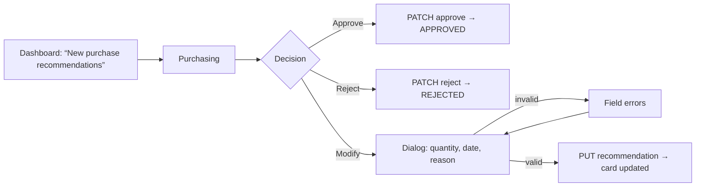

# Frontend architecture

Single-page application in React 18 + Vite that runs in any modern browser on phones, tablets and desktops. Decision record: [ADR-0012](../Documentation/adr/0012-browser-ui-javascript.md). Conventions: [CODE_STYLE_FRONTEND.md](../Documentation/CODE_STYLE_FRONTEND.md). Design system and adaptive layout: [DESIGN_SYSTEM.md](../Documentation/design/DESIGN_SYSTEM.md).

## System context



The UI talks to the backend only through its REST API on the same origin (no CORS, `HttpOnly` cookie). In demo mode (`VITE_API_MOCK=true`), [MSW](https://mswjs.io/) answers the same requests inside the browser. That is how the GitHub Pages demo and the e2e tests run without a backend.

## Layers inside the SPA



| Folder                 | Responsibility                                                    | Rule                                                          |
| ---------------------- | ----------------------------------------------------------------- | ------------------------------------------------------------- |
| `src/features/<area>/` | One business area: page component, its data hook and CSS module   | Pages never call `fetch`; they use their hook                 |
| `src/components/`      | Reusable, domain-free UI components                               | No API calls, no knowledge of products/shelves                |
| `src/api/`             | **Services for API calls**: one module per backend resource       | The only place that knows REST paths and DTO shapes           |
| `src/api/http.js`      | Low-level HTTP: JSON, errors, 401                                 | Every non-2xx becomes an `ApiError { status, code, message }` |
| `src/hooks/`           | Cross-cutting hooks: auth, data loading, mutations, media queries |                                                               |
| `src/core/`            | Pure functions: validation rules, stock thresholds, formatting    | No React, fully unit-tested                                   |
| `src/mocks/`           | MSW handlers + in-memory data mirroring the Spring controllers    | Not included in the production bundle                         |
| `src/styles/`          | Design tokens and global CSS                                      | Single source of colours, type, spacing                       |

## Forms, errors and loading states

| Concern                   | Where                                                                                                                                                                                                                                                                   | How                                                                                                                                                                                                                                               |
| ------------------------- | ----------------------------------------------------------------------------------------------------------------------------------------------------------------------------------------------------------------------------------------------------------------------- | ------------------------------------------------------------------------------------------------------------------------------------------------------------------------------------------------------------------------------------------------- |
| **Form validation**       | [`core/validation.js`](src/core/validation.js), used by [`LoginPage`](src/features/auth/LoginPage.jsx), [`DevicesPage`](src/features/devices/DevicesPage.jsx) (register camera), [`RecommendationsPage`](src/features/recommendations/RecommendationsPage.jsx) (modify) | Validated on submit. Each error appears under its field ([`Field`](src/components/Field.jsx), `aria-invalid` + `aria-describedby`). A server 400/409 message appears at the top of the form and the form stays open.                              |
| **Global error handling** | [`components/ErrorBoundary.jsx`](src/components/ErrorBoundary.jsx), [`core/errors.js`](src/core/errors.js), [`main.jsx`](src/main.jsx), [`AppShell.jsx`](src/AppShell.jsx)                                                                                              | A root boundary catches any render crash. A per-screen boundary keeps the navigation working and resets on route change. `window.error` and `unhandledrejection` go to `reportError`. A failed bootstrap shows a message instead of a blank page. |
| **API errors**            | [`api/http.js`](src/api/http.js), [`hooks/useAuth.jsx`](src/hooks/useAuth.jsx)                                                                                                                                                                                          | One `ApiError` type with a stable `code`. Network failures become `NETWORK_ERROR`. Any 401 signs the user out globally and returns them to `/login`.                                                                                              |
| **Loading states**        | [`components/StateView.jsx`](src/components/StateView.jsx), `busy` prop of [`Button`](src/components/Button.jsx), `Suspense` fallbacks in [`App.jsx`](src/App.jsx)                                                                                                      | Every data view shows loading → error (with "Try again") → empty → content. Action buttons show a spinner and lock while their request runs. Lazy-loaded pages show the same spinner.                                                             |

## User flows

### 1. Sign in (all roles)



### 2. Review an uncertain recognition (worker, typically on a phone)



### 3. Decide on a purchase recommendation (manager, typically on a desktop)



### 4. Register a shelf camera (admin)

Devices → **Register camera** → device key (validated against the shelf agent format) + free shelf → the camera appears in the list. A duplicate key or an occupied shelf returns the server's 409 message inside the dialog.

## Technology choices

| Need                   | Choice                                                       | Why (alternatives in [ADR-0012](../Documentation/adr/0012-browser-ui-javascript.md))                                                                                         |
| ---------------------- | ------------------------------------------------------------ | ---------------------------------------------------------------------------------------------------------------------------------------------------------------------------- |
| UI framework           | **React 18**                                                 | Component model fits a dashboard of reusable cards, tables and forms. Largest ecosystem and documentation, which matters for a team learning JS. Vue 3 was equally suitable. |
| Bundler / dev server   | **Vite 5**                                                   | Instant dev start, HMR, `/api` proxy for local backend, code-splitting of lazy pages, tiny config                                                                            |
| Routing                | **React Router 6**                                           | De-facto standard; nested routes give one shell with many pages; route guards for roles                                                                                      |
| Language               | **JavaScript + JSDoc**                                       | No compile step to learn; JSDoc keeps types visible in the editor; a file-by-file move to TypeScript stays possible                                                          |
| Styling                | **CSS Modules + CSS custom properties**                      | Scoped class names without a runtime; tokens shared by every component and exported to Figma; mobile-first media queries                                                     |
| Charts                 | **Chart.js + react-chartjs-2**                               | Responsive canvas charts, MIT, small API                                                                                                                                     |
| Server state           | Own `useResource` / `useMutation` hooks                      | A handful of endpoints with polling; a library like TanStack Query would be more to learn than the code it replaces                                                          |
| API mocking            | **MSW 2**                                                    | The same handlers serve the browser (demo), Vitest and Playwright, so the UI is built and tested before the backend is ready                                                 |
| Unit / component tests | **Vitest + React Testing Library**                           | Same config as Vite; tests use the UI the way a user does (roles, labels)                                                                                                    |
| E2E tests              | **Playwright**                                               | Real Chromium, device emulation (viewport, touch), auto-waiting; runs headless in CI                                                                                         |
| Quality                | ESLint (react, hooks, jsx-a11y) + Prettier + license-checker | Accessibility lint rules and permissive-licence gate in CI                                                                                                                   |

## Tests

| Kind                        | Files                                                                                                                                                                            | Covers                                                                                                                                 |
| --------------------------- | -------------------------------------------------------------------------------------------------------------------------------------------------------------------------------- | -------------------------------------------------------------------------------------------------------------------------------------- |
| Unit: logic                 | `src/core/*.test.js`, `src/api/http.test.js`                                                                                                                                     | Validation rules, stock rules, HTTP error mapping                                                                                      |
| Component                   | `src/components/DataTable.test.jsx`, `src/components/ErrorBoundary.test.jsx`                                                                                                     | Table ↔ card layout, paging; crash fallback, retry, reset                                                                             |
| Page (component + mock API) | `src/features/auth/LoginPage.test.jsx`, `src/features/devices/DevicesPage.test.jsx`, `src/features/recognition/ReviewPage.test.jsx`, `src/features/shelves/ShelvesPage.test.jsx` | Form validation, server errors, role-based navigation, confirming a recognition                                                        |
| E2E (Playwright)            | `e2e/review-on-phone.spec.js`, `e2e/recommendation-on-desktop.spec.js`                                                                                                           | Full user flows 1–3 in a real browser on phone and desktop sizes                                                                       |
| E2E: adaptive               | `e2e/adaptive.spec.js`                                                                                                                                                           | Every screen × 6 viewport/orientation/zoom variants: no sideways scroll, nav visible, 44px touch targets, no overlap, WCAG AA contrast |

```bash
npm test            # Vitest
npm run test:e2e    # Playwright (starts its own dev server on :5174)
```
